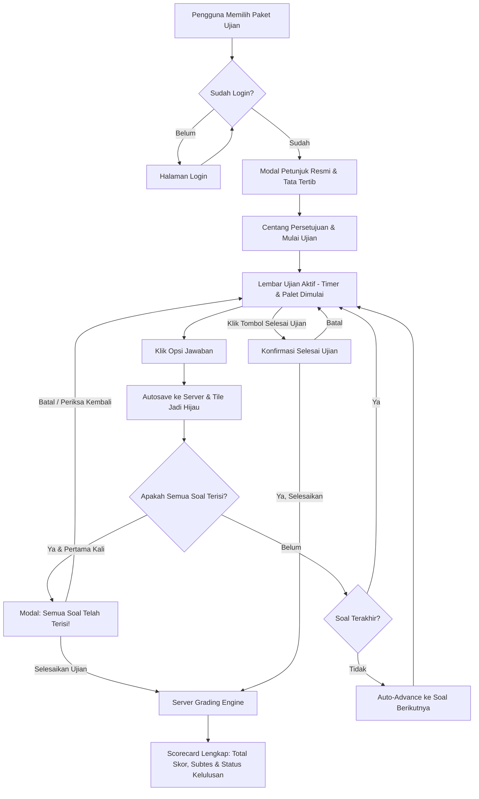

<div align="center">

# 🏛️ SIMCAT — Platform Simulasi CAT Nasional 2026
**Platform Pembelajaran, Tryout, dan Simulasi Computer Assisted Test (CAT) Terpadu untuk CPNS, PPPK, BUMN, dan Sekolah Kedinasan**

[](https://astro.build)
[](https://nodejs.org)
[](https://www.typescriptlang.org)
[](LICENSE)
[]()

[Fitur Utama](#-fitur-unggulan) • [Alur Simulasi](#-alur-simulasi-ujian-cat) • [Instalasi](#-panduan-instalasi--menjalankan-lokal) • [Akun Demo](#-akun-demo-untuk-pengujian) • [Struktur Proyek](#-struktur-arsitektur-proyek) • [Deploy cPanel](#-panduan-deployment)

</div>

---

## 📌 Tentang SIMCAT

**SIMCAT** adalah platform simulasi ujian berbasis komputer yang dirancang untuk menghadirkan pengalaman latihan paling realistis bagi calon pelamar seleksi nasional di Indonesia, meliputi:

1. **CPNS (Calon Pegawai Negeri Sipil)**: SKD (TWK, TIU, TKP) dengan standar penilaian KepmenPAN-RB.
2. **PPPK (Pegawai Pemerintah dengan Perjanjian Kerja)**: Kompetensi Teknis, Manajerial, Sosio-kultural, dan Wawancara.
3. **BUMN**: Tes Kemampuan Dasar (TKD) dan Core Values AKHLAK.
4. **Sekolah Kedinasan**: IPDN, STAN, Poltekip/Poltekim, STIN, STIS, dsb.

SIMCAT dibangun mengutamakan **performa tinggi, antarmuka minimalis bebas silau (*low eye-strain*), sistem penilaian terverifikasi server (*server-authoritative*), dan keandalan autosave berkala**.

---

## ✨ Fitur Unggulan

### 1. 🖥️ Antarmuka Simulasi CAT Realistis (Minimalis & Bebas Silau)
- **Mode Light Khusus Ujian**: Layar ujian dirancang dengan nuansa abu-abu slate dan putih bersih yang menenangkan mata selama 100+ menit pengerjaan.
- **Server-Locked Digital Timer**: Hitung mundur durasi ujian yang disinkronkan secara otoritatif oleh server untuk mencegah manipulasi waktu di sisi peramban (*client*).
- **Pengatur Ukuran Teks (`A-`, `A`, `A+`)**: Mengubah ukuran font stimulus dan pilihan jawaban secara instan sesuai kenyamanan peserta.
- **Dukungan Stimulus & Bacaan Panjang**: Kotak teks bacaan terformat khusus untuk soal penalaran wacana, studi kasus, atau grafik.

### 2. 🎨 Navigasi Nomor Soal Berwarna (*Interactive Number Palette*)
Nomor soal memiliki visual kontras dan mikro-badge aksidental untuk membedakan status dengan jelas:
- 🟩 **Hijau Emerald (`✓`) — Dijawab**: Opsi telah dipilih dan tersimpan di database.
- 🟨 **Kuning Amber (`?`) — Ragu-Ragu**: Ditandai peserta untuk ditinjau ulang sebelum mengakhiri ujian.
- 🟥 **Merah Coral (`!`) — Dilewati**: Soal pernah dibuka/dikunjungi namun dilewati tanpa memilih opsi jawaban.
- ⬜ **Abu-abu Slate — Belum Dibuka**: Soal belum pernah dilihat/dibuka sejak ujian dimulai.
- 🔵 **Ring Biru Elektrik (Menyala)**: Menandai butir nomor soal yang sedang aktif di layar.
- **Ukuran Compact & Rapi**: Panel navigasi berukuran 280px yang hemat ruang dan proporsional.

### 3. ⚡ Alur Pengerjaan Cepat (*Auto-Advance & Smart Completion Notice*)
- **Otomatis Lanjut ke Soal Berikutnya**: Ketika peserta mengklik opsi jawaban (A/B/C/D/E), sistem langsung menyimpan jawaban dan secara mulus berpindah ke nomor soal berikutnya (jeda 220ms).
- **Peringatan Kelengkapan Soal (100%)**: Saat butir soal terakhir yang kosong diisi, sistem otomatis menampilkan notifikasi konfirmasi bahwa semua soal telah terisi.
- **Tombol Batal / Periksa Kembali**: Peserta dapat menutup peringatan kapan saja (melalui tombol batal, tombol silang `×`, klik backdrop, atau tombol `Esc`) untuk memeriksa kembali seluruh jawaban tanpa terganggu.

### 4. ⚖️ Sistem Penilaian Otoritatif & Passing Grade BKN
- **Penilaian Berbobot Resmi**:
  - **TWK & TIU**: Benar = 5 poin, Salah/Kosong = 0 poin.
  - **TKP**: Skala bertingkat 1 sampai 5 poin untuk setiap opsi pilihan (tidak ada nilai 0 jika dijawab).
- **Verifikasi Ambang Batas Otomatis**: Menghitung status **LULUS / TIDAK MEMENUHI SYARAT (TMS)** berdasarkan passing grade resmi per subtes (TWK: 65, TIU: 80, TKP: 166).

### 5. 🔐 Autentikasi & Keamanan Sesi
- **Cek Login Sebelum Simulasi**: Pengguna yang belum login otomatis diarahkan ke halaman masuk terlebih dahulu sebelum dapat mengakses lembar soal.
- **Role-Based Access Control (RBAC)**: Pemisahan hak akses antara Peserta (*Examinee*), Penulis/Reviewer Soal, dan Administrator.
- **Autosave Realtime**: Setiap klik jawaban disimpan dengan nomor urut transaksi (*sequence counter*) ke database SQLite/MySQL server.

---

## 🧭 Alur Simulasi Ujian CAT



---

## 💻 Panduan Instalasi & Menjalankan Lokal

### Prasyarat Sistem
- **Node.js**: Versi `v22.x` atau lebih baru
- **NPM**: Versi `10.x` atau lebih baru

### Langkah-langkah

1. **Clone repositori**:
   ```bash
   git clone https://github.com/username/latihan-ujian-cpanel-astro.git
   cd latihan-ujian-cpanel-astro
   ```

2. **Pasang dependensi**:
   ```bash
   npm install
   ```

3. **Inisialisasi Database (SQLite bawaan)**:
   Database default telah terkonfigurasi pada folder `database/` dan siap pakai secara otomatis.

4. **Jalankan development server**:
   ```bash
   npm run dev
   ```
   Aplikasi akan aktif di `http://localhost:4321`.

5. **Build untuk Produksi**:
   ```bash
   npm run build
   ```

---

## 👥 Akun Demo untuk Pengujian

Gunakan akun demo berikut untuk menguji berbagai fitur SIMCAT:

| Peran (Role) | Email | Kata Sandi | Deskripsi Akses |
| :--- | :--- | :--- | :--- |
| **Peserta Ujian (Examinee)** | `budi@example.com` | `password123` | Mengikuti tryout, simulasi ujian, riwayat skor |
| **Peserta Ujian 2** | `examinee@simcat.id` | `password123` | Akun peserta alternatif |
| **Administrator** | `admin@simcat.id` | `password123` | Dashboard admin, kelola paket ujian, audit log |
| **Reviewer Soal** | `guru@simcat.id` | `password123` | Bank soal, validasi kunci jawaban dan stimulus |

---

## 📂 Struktur Arsitektur Proyek

```
latihan-ujian-cpanel-astro/
├── cpanel-api/                 # Skrip endpoint PHP PDO untuk hosting cPanel tradisional
│   ├── config.php              # Konfigurasi koneksi MySQL cPanel & header CORS
│   ├── get_questions.php       # API pengambilan butir soal
│   └── save_result.php         # API penyimpanan nilai dan riwayat
├── database/                   # Skema dan basis data
│   ├── schema.sql              # DDL MySQL & data seed lengkap
│   └── simcat.db               # Database SQLite lokal (Node.js runtime)
├── public/                     # Aset statis peramban
│   ├── .htaccess               # Apache clean URL routing untuk cPanel
│   └── favicon.svg             # Logo branding SIMCAT
├── src/
│   ├── components/             # Komponen antarmuka Astro
│   │   ├── Navbar.astro        # Header navigasi & status sesi user
│   │   ├── Footer.astro        # Footer resmi & informasi platform
│   │   └── CategoryCard.astro  # Kartu etalase paket ujian
│   ├── data/                   # Definisi paket soal & TypeScript interfaces
│   │   ├── cpns-skd.ts         # Bank soal CPNS SKD (TWK, TIU, TKP)
│   │   ├── pppk.ts             # Bank soal PPPK
│   │   ├── polri.ts            # Bank soal Kepolisian
│   │   ├── tni.ts              # Bank soal TNI
│   │   └── types.ts            # Model data Exam, Question, Subtest
│   ├── layouts/
│   │   └── Layout.astro        # Layout induk SEO & metadata OpenGraph
│   ├── pages/                  # Routing Astro (SSR & API Endpoints)
│   │   ├── api/
│   │   │   └── exam/
│   │   │       ├── start.ts         # Mulai sesi ujian & server token
│   │   │       ├── save-answer.ts   # Autosave jawaban realtime
│   │   │       ├── heartbeat.ts     # Sinkronisasi timer server
│   │   │       └── finish.ts        # Server-authoritative grading engine
│   │   ├── index.astro         # Beranda utama SIMCAT
│   │   ├── login.astro         # Portal autentikasi peserta
│   │   ├── simulasi/
│   │   │   └── [slug].astro    # Lembar pengerjaan simulasi CAT interaktif
│   │   ├── pembahasan/
│   │   │   └── [slug].astro    # Kunci jawaban, penjelasan, & trik cepat
│   │   ├── riwayat.astro       # Riwayat pengerjaan & grafik progres skor
│   │   └── admin/              # Panel pengelolaan bank soal & audit log
│   ├── services/               # Lapisan logika bisnis & database handler
│   │   └── examService.ts      # Engine manajemen ujian & grading
│   └── styles/
│       ├── global.css          # Design tokens, typography & dark glassmorphism
│       └── exam.css            # Desain khusus mode ujian CAT (Minimalis Light)
├── package.json
└── tsconfig.json
```

---

## 🌐 Panduan Deployment

### Opsi A: Deployment Server Node.js / VPS / Cloud Run
SIMCAT menggunakan adapter `@astrojs/node` dengan mode `output: "server"`:
```bash
# 1. Jalankan build produksi
npm run build

# 2. Jalankan server produksi
HOST=0.0.0.0 PORT=4321 node ./dist/server/entry.mjs
```

### Opsi B: Deployment ke Shared Hosting cPanel & MySQL
1. Buat database MySQL di cPanel melalui menu **MySQL Database Wizard**.
2. Masuk ke **phpMyAdmin**, pilih database Anda, lalu import berkas [`database/schema.sql`](database/schema.sql).
3. Upload konten API PHP dari folder `cpanel-api/` ke `public_html/api/`.
4. Sesuaikan nama database, username, dan password pada berkas `public_html/api/config.php`.
5. Upload berkas hasil build dan berkas [`.htaccess`](public/.htaccess) ke root `public_html/`.

---

## 📜 Lisensi & Penafian

- **Lisensi**: Proyek ini dilisensikan di bawah lisensi [MIT](LICENSE).
- **Penafian (*Disclaimer*)**: SIMCAT adalah platform pembelajaran dan simulasi latihan mandiri. SIMCAT bukan merupakan penyelenggara seleksi resmi dari Badan Kepegawaian Negara (BKN) maupun instansi kementerian/pemerintah manapun. Seluruh materi soal dan passing grade mengacu pada peraturan perundang-undangan yang berlaku sebagai indikator persiapan peserta.

---

<div align="center">
  <sub>Dibangun dengan dedikasi untuk mendukung calon abdi negara dan talenta terbaik Indonesia.</sub>
</div>
